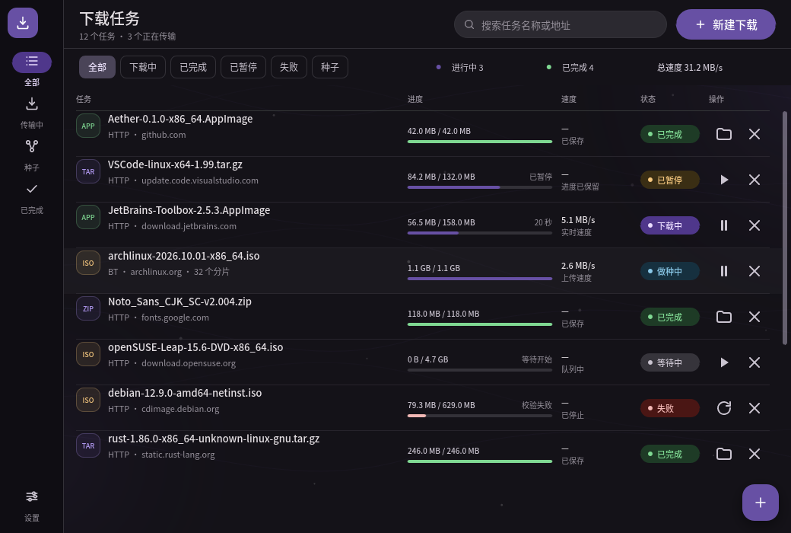
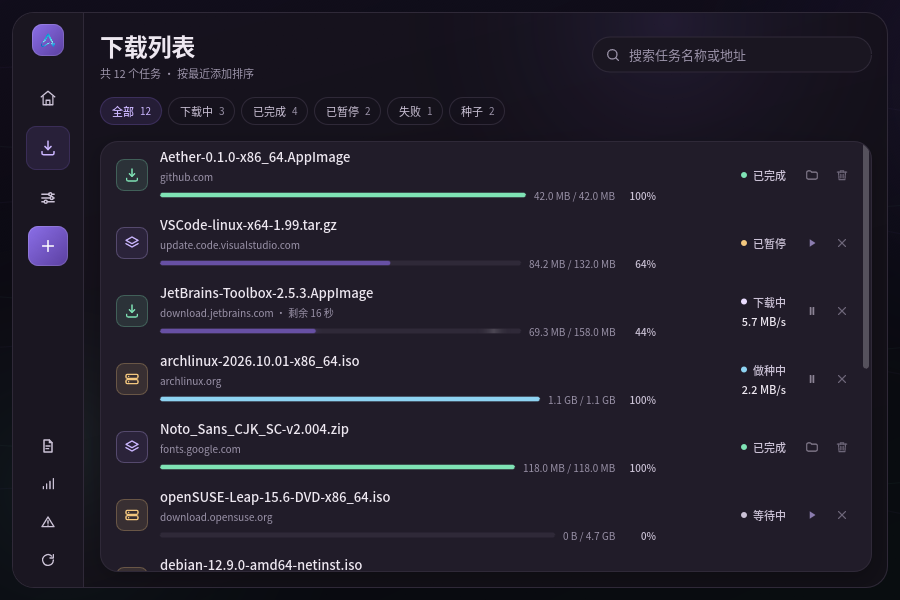
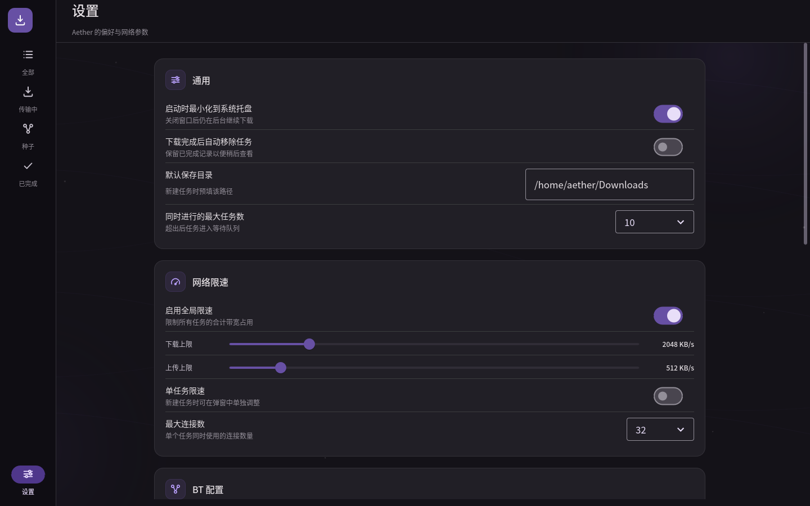
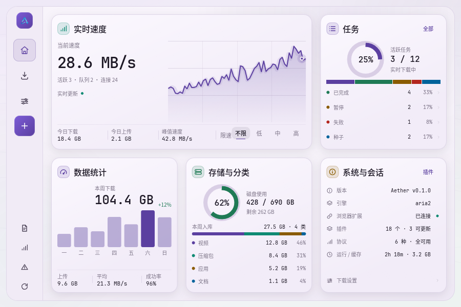
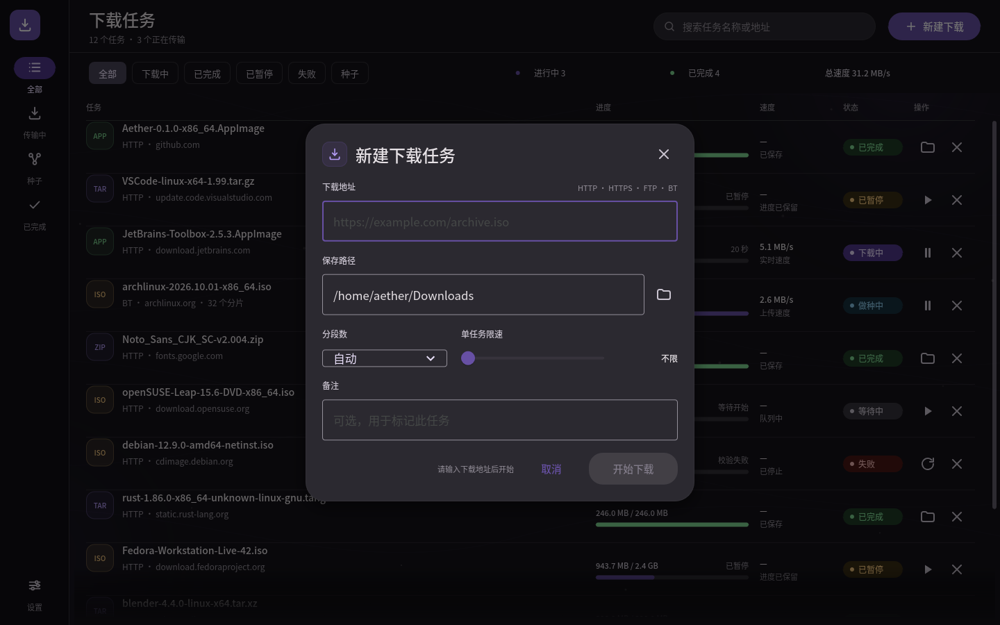
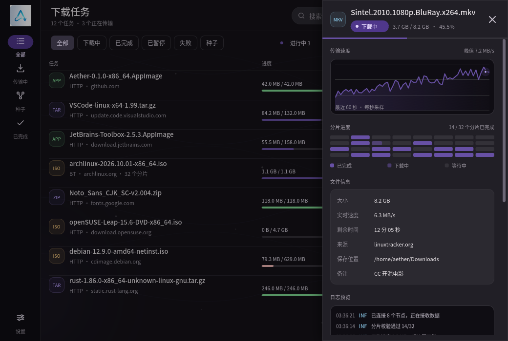

<p align="center"></p>

# Aether

**原生 Material 3 全能下载工具 · Rust + Slint · 无 WebView**

Aether 是一个 Rust + Slint 的桌面下载管理器：窗口通过本地 socket 连接常驻的
`aether-daemon`，任务、进度、暂停/继续/取消、新建下载与代理设置都走真实后端
（16 个第一方插件）。交互与视觉参考 Motrix，完全用 Rust 与
[Slint](https://slint.dev) 绘制：没有 Electron、没有 Chromium。除品牌 logo 外，
窗口里的图标、进度条、折线图和背景流线全部是矢量渲染。

产品结构只有 **3 个一级入口**：**主页 / 下载 / 设置**。主页是控制台（资源、统计、插件、
支持、记录），下载页专注任务列表，设置页展开为完整的多分类中心。视觉采用 **aurora ink**
语言：`#6750A4` 品牌紫、薄荷色实时状态、plum-black / lavender 双主题表面和低对比环境光。

主题支持 **浅色 / 深色 / 跟随系统** 三种选择，默认跟随系统；自定义 Aether token 与
Material 组件会一起切换。

---

## 界面预览

### 主页

主页是卡片化控制台，五张卡共用一套卡片规范：16px 圆角、26px 图标标题栏、12px 内边距、
统一边线和阴影。

- **实时速度**（跨 2 列）：当前速度、活跃/队列/连接状态、实时曲线，今日下载 / 上传 /
  峰值速度，以及限速预设
- **任务**（1 列）：活跃任务环图、任务总数与占比、状态分布条，以及已完成 / 暂停 /
  失败 / 种子的数量与占比；点击任一行进入对应筛选
- **数据统计**：本周下载总量、7 天流量柱图、上传 / 平均速度 / 成功率
- **存储与分类**：磁盘使用环图、本周入库总量、视频 / 压缩包 / 应用 / 文档分类占比
- **系统与会话**：版本、下载引擎、浏览器扩展、插件、协议汇总、运行时长 / 缓存与
  下载设置入口

支持入口在左侧栏底部。窗口默认 900×600，最小 900×560，主页完整落在单屏内。



### 下载列表

下载页不混入主页内容，只有一条可读的任务列表：本地筛选/搜索、文件名、来源、进度、大小、
剩余时间、实时速度、状态和行内操作。筛选属于这个页面，不再出现在全局菜单里。



### 设置中心

设置页是独立的多分类中心：左侧 10 个分类，右侧是 M3 分组卡片。覆盖下载并发、连接数、
动态分段、重试与超时、全局限速、磁盘预分配、校验、代理、DNS、请求头、BT/PT、DHT/PEX、
做种、媒体嗅探、浏览器接管、插件、计划任务、通知、外观、RPC 与维护等能力。



### 插件

主页系统卡显示插件总数和可更新数量；设置 → 插件是完整目录：
**18 个插件（15 个内置、
3 个社区）**，支持按全部/内置/已启用/可更新筛选，单独启停、更新全部、安装、插件目录、
自动更新与开发者模式。插件在独立进程中运行（`crates/aether-plugin-sdk`）；插件页目前
仍是目录展示，启停/安装尚未下发到 daemon。


### 双主题

主题选择共 3 项：**浅色 / 深色 / 跟随系统**，默认跟随系统。选择会立即切换自定义 token、
卡片渐变、状态色以及上游 Material 控件，并写入用户配置（`~/.config/aether/theme`，
Windows / macOS 使用对应平台目录）；应用还会在跟随系统模式下周期性检查桌面主题。




### 新建下载

左栏 `+` 打开新建下载。表单保留图标化字段和输入值，标题、字段名、帮助文案都收进悬停
提示；Enter 提交、Esc 关闭，URL 为空时提交图标保持禁用态。确认后自动切到下载列表。



### 任务详情

任务行点击后打开紧凑的 icon inspector：文件 glyph、状态点、进度线、操作图标、三枚指标
图标、无标签速度图、分片网格和信息图标。标签与数值都在悬停提示里，日志与 BT 节点列表
不属于当前界面范围。



---

## 运行

前置条件：

- Rust 1.92 或更新版本
- Linux 桌面（X11 或 Wayland）
- OpenGL 驱动；无 GPU 时 Slint 会回退到软件渲染

```bash
cargo run --release
```

首次构建需要编译 Slint 与整套 Material 组件，耗时略长；之后的增量构建在数秒内完成。

### 开发用启动参数

```bash
AETHER_VIEW=home      cargo run   # 默认，主页控制台
AETHER_VIEW=downloads cargo run   # 直接打开下载列表
AETHER_VIEW=settings  cargo run   # 直接打开设置中心
AETHER_VIEW=dialog    cargo run   # 直接打开新建下载
AETHER_VIEW=drawer    cargo run   # 打开一个正在下载的任务 inspector

AETHER_THEME=light    cargo run   # 临时固定浅色（也可 dark）
```

不设置 `AETHER_THEME` 时使用已保存的主题；首次启动默认跟随系统。应用会读取
GNOME / Windows / macOS 的桌面明暗偏好，并在“跟随系统”模式下每 10 秒检查一次变化。

### 截图脚本

`scripts/shot.sh` 会在私有 Xvfb 显示（默认 `:97`）上启动应用并抓图，不打扰当前桌面：

```bash
./scripts/shot.sh /tmp/aether.png 6             # 输出路径、等待秒数
AETHER_VIEW=downloads ./scripts/shot.sh /tmp/downloads.png
AETHER_THEME=light ./scripts/shot.sh /tmp/light.png
```

依赖 `Xvfb` 与 ImageMagick 的 `import`；若安装了 `xdotool`，脚本会先把指针移出内容区，
避免截到悬停/焦点态。窗口默认 900×600，可在 900×560 以上自由缩放；脚本默认画布与窗口一致。

### 打包与安装

发布包由 GitHub Actions 生成，**只有 `release/*` 分支会触发打包**；分支名必须与
`Cargo.toml` 的版本一致。

```bash
git switch -c release/0.1.0
git push -u origin release/0.1.0
```

同一套源码在 CI 中构建全平台产物：

| 平台 | 产物 | 说明 |
| --- | --- | --- |
| Linux x86_64 | `.deb` + `.AppImage` | `.deb` 安装到 `/usr`；AppImage 可移动 |
| Windows x86_64 | `setup.exe` + portable `.zip` | 安装器含开始菜单/桌面快捷方式；随附 daemon/CLI/native-host 与全部第一方插件 |
| macOS universal | `.dmg` | Apple Silicon + Intel；未签名，需右键打开 |

所有产物会附加到一个 **draft GitHub Release**（tag `v<version>`），确认后发布即可。构建只在
release 分支进行，`main`/feature 提交不会产生包。每个包都必须携带 `LICENSE`、
`THIRD_PARTY_NOTICES.md` 与 `LICENSES/Slint-Royalty-free-2.0.md`；发布前由
`make check-licenses` 和 `scripts/check-license-bundles.py` 检查实际产物。

Linux 本地验证：

```bash
make check   # desktop-file-validate + AppStream 校验
make deb     # dist/aether_0.1.0_amd64.deb
sudo apt install ./dist/aether_0.1.0_amd64.deb
```

`.deb` 在 Ubuntu 24.04 上构建，要求 glibc 2.39+；macOS 包为 universal（arm64 + x86_64），
但未做 Apple notarization。Windows 安装器由 Inno Setup 生成，便携版解压即用。

### 应用图标规范

- 画布：GNOME HIG 的 128×128 名义尺寸；仓库导出 32/48/64/128/256/512，安装到 hicolor。
- 底板：Ubuntu Yaru 方形图标按 224/256（87.5%）绘制，256 画布外缘 2px 描边；对应 512
  画布即 448px 底板、4px 描边。100% 铺满会明显大于其他 Dock 图标，75% 又会偏小。
- Dock 使用 48px 资产；桌面、Dock 和窗口图标使用浅色半透明磨砂底，左栏品牌标记使用去底版本。
- 图标名与 `.desktop` 的 `Icon` 都使用 app id `aether`，并安装到 `hicolor/{32,48,64,128,256,512}x…/apps/`。
- 发布包由 `.deb` 安装到 `/usr`；AppStream 组件 ID 使用反向域名
  `io.github.pengtang1024.Aether`。
- GNOME HIG 通用模板更保守（104/128 底板）；Ubuntu Yaru 的方形底板更大，本应用在 Ubuntu
  Dock 中按 Yaru 的比例对齐。

---

## 项目结构

```
.
├── build.rs                 # 注册 "material" 样式、include 路径
├── src/
│   ├── main.rs              # UI 胶水层：过滤/搜索、聚合统计、记录、主题检测、定时器
│   ├── backend.rs           # daemon 桥：订阅事件、命令通道、快照、稳定 id 映射
│   ├── chart.rs             # 速度折线/面积几何
│   └── model.rs             # Task / Status 领域模型与格式化
├── ui/
│   ├── app.slint            # 左侧导航外壳、页面路由、主题应用、覆盖层
│   ├── theme.slint          # 浅/深双主题 token、状态色与文件类型色
│   ├── icons.slint          # SVG 图标注册表（34 个）
│   ├── widgets.slint        # RailButton、Tip、FileGlyph、分组卡片、速度图、分片网格
│   ├── model.slint          # 与 Rust 共享的 Task / Detail / Record 结构体
│   ├── pages/
│   │   ├── home.slint       # 卡片控制台：速度、任务、统计、存储、系统
│   │   ├── downloads.slint  # 下载列表、本地筛选与搜索
│   │   ├── settings.slint   # 10 分类设置中心
│   │   ├── new-download.slint
│   │   └── task-drawer.slint
│   ├── plugins.slint        # 18 个插件的展示目录（15 内置 / 3 社区）
│   └── material/            # vendored Slint 1.18.1 Material 3 组件库
├── crates/
│   ├── aether-plugin-sdk/   # 首方插件协议、IPC framing 与 manifest 校验
│   └── aether-plugin-fake/  # SDK 的测试插件
├── assets/
│   ├── icons/               # 单色描边 SVG（34 个），使用时 colorize
│   ├── logo.png                 # 原始 logo（带浅色底板）
│   ├── logo-transparent-128.png # 左栏品牌标记（去背景）
│   ├── logo-transparent-512.png # 去背景高分辨率版本
│   ├── logo-icon-*.png          # hicolor 32–512 图标（半透明磨砂底）
│   ├── logo.ico                 # Windows 安装器/快捷方式图标
├── packaging/                # desktop / AppStream / Debian / Windows / macOS
├── .github/workflows/        # release 分支全平台打包
├── Makefile                  # make check / make deb
├── docs/
│   ├── DESIGN_SYSTEM.md      # 类型比例、组件尺寸、间距与圆角规范
│   └── screenshots/          # light / dark 界面截图
└── scripts/shot.sh
```

### 数据流

```
Slint 回调  →  main.rs 意图处理  →  Engine 状态变更
    ↑                                    │
    └──  VecModel / 属性更新 / 聚合统计 / 全局曲线 / 记录 ┘
```

UI 不直接写任务状态。暂停、继续、取消/删除、新建都变成 `main.rs` 里的意图，经
`backend.rs` 的命令通道发给 daemon；daemon 的 `subscribe` 事件流回来后合成快照，UI 每
200 ms 取一次快照，以最小 diff 写回 `VecModel`。全局限速曲线来自后端每秒采样；详情抽屉
按需刷新图表与分片。主题由 UI 选择 + Rust 系统探测共同决定，`Aether.dark` 驱动自绘
token，`ColorSchemeSelector` 驱动 Material 控件。

---

## 设计说明

完整的类型比例、组件尺寸、间距与圆角规范见 [docs/DESIGN_SYSTEM.md](docs/DESIGN_SYSTEM.md)。令牌集中在 `ui/theme.slint`；页面不再写裸字号和一次性高度。

**左侧图标导航。** 左侧 72px 导航栏固定 3 个一级入口（主页 / 下载 / 设置），底部是
支持入口，名称显示在导航栏内的固定提示位，不改变按钮布局，因此悬停不会抖动。筛选属于
下载页，分类属于设置页，全局导航只承担页面切换。左栏从上到下是品牌、主页 / 下载 / 设置、
新建下载 `+` 和支持入口；内容区不再保留空顶栏。

**主页是卡片化控制台。** 五张卡放在同一套 3 列网格上：上排实时速度跨 2 列、任务卡 1 列；
下排数据统计、存储分类、系统会话各 1 列。卡片复用同一套 Card 规范——16px 圆角、26px
标题图标、12px 内边距、统一阴影和边线；卡边、列轨和上下排间距对齐。实时速度卡带今日
下载 / 上传 / 峰值和限速预设；任务卡用活跃任务环图 +「3 / 12」+ 状态分布条 + 四条状态明细
表达任务结构；数据统计卡展示本周总量和 7 天柱图；存储卡展示磁盘和分类占比；系统卡承载
版本、引擎、扩展、插件、协议汇总和会话信息。主页不混入任务列表；任务列表在下载页里完整展开。

**下载页是列表。** 本地筛选 chip 带计数，搜索框只影响列表；行内展示文件名、来源、进度、
大小、百分比、剩余时间、速度和状态，操作按钮在悬停时提亮。列表使用虚拟化 `ListView`，
默认 900×600 下可见 5 行左右，滚动条独立于卡片。

**设置中心是全能工具的面板。** 设置页使用左侧分类导航 + 右侧分组卡片，包含常规、下载、
网络、BT/PT、媒体与浏览器、插件、计划与通知、外观、高级、关于与支持。下载项覆盖并发、
连接、分段、动态分段、重试、超时、带宽、预分配、校验、完成动作；网络项覆盖代理、DNS、
IPv6、User-Agent、请求头、HTTP/2、FTP 被动、镜像；BT/PT 覆盖端口、加密、DHT/PEX/LSD、
uTP、上传、做种比例、Peer 上限、IP 过滤与 Tracker；另有媒体嗅探/ffmpeg、浏览器接管、
18 个插件（15 内置 / 3 社区）的管理目录、计划任务、通知、RPC 与诊断。

**双主题。** 自定义 token 全部从 `Aether.dark` 派生：表面、卡片渐变、画布、弹窗、
抽屉、遮罩、阴影、代码与状态色都有浅/深值。上游 Material 控件通过
`ColorSchemeSelector` 切换。设置提供 **浅色 / 深色 / 跟随系统** 3 项，默认跟随系统；
Rust 在 Linux 读取 `gsettings`，Windows 读取注册表，macOS 读取
`AppleInterfaceStyle`，并在跟随系统时每 10 秒复查。主题选择会持久化，首次启动（或配置为
`跟随系统`）时跟随桌面；`AETHER_THEME=light|dark` 可用于截图或测试。

**Material 3。** 直接使用 Slint 官方 Material 3 组件库，而不是手写一套仿 M3 控件。
`build.rs` 通过 `with_style("material")` 把 vendored 的 Slint 1.18.1 组件注册为样式；
设置、弹窗、抽屉和列表中的开关、滑块、下拉框、单行输入框与图标按钮来自上游实现；
导航、卡片、Tip、FileGlyph、速度图、分片网格等业务组件复用同一套令牌与
`StateLayer`（涟漪、悬停、焦点）。

**Aurora ink。** 深色为 plum-black（`#0A0810` → `#141119` → `#211C29`），浅色为
lavender（`#ECE5F1` → `#F7F3FA` → `#E2D9EC`）。主色 `#6750A4`，实时状态用薄荷
`#6FE3C4`（深）/ `#0F8A73`（浅）；状态色、文件类型色和进度条颜色随主题一起切换。

**留白与层级。** 左栏 72 px 贯穿全高，内容区离窗口边缘 12 px；主页卡片 18 px 圆角、14 px 内边距；
下载行高 68 px；设置分类栏 214 px。卡片的悬浮感来自低透明度阴影与顶部高光，而不是
粗边框；画布顶部保留一条紫到薄荷的 1 px 极光线。

**矢量图表。** Slint 1.18 还没有 `Canvas`。主页和 inspector 的速度图用 `Path` 的 SVG
`commands` 绘制，归一化到 0..1 后用 `ImageFit.fill` 拉伸；分片网格、进度轨和背景流线同理。
图标是单色描边 SVG，由 `colorize` 在使用处着色，因此能跟随主题。

**虚拟化与命中测试。** 列表用 `ListView`，只实例化视口内的行；整行 TouchArea 先声明，
行内操作在内容层上方，空白区域仍能打开 inspector。主页/设置/详情中的悬停提示、指标
Tip 与卡片交互各自独立，不依赖系统 Tooltip 窗口。

**键盘与空状态。** 新建对话框自动聚焦 URL，Enter 提交、Esc 关闭；任务 inspector 支持
Esc 关闭；下载空状态提供“清除筛选条件”，一次恢复全部任务。

### 对 vendored 组件的改动

`ui/material/` 来自 Slint 1.18.1 的 `widgets/{material,common,interfaces}`，保留上游版权头，
做了几处小而局部的补丁：

| 文件 | 改动 |
| --- | --- |
| `styling.slint` | aurora ink 色板与浅/深 surface 阶梯 |
| `color-scheme.slint` | 主题方案改为可由 app shell 读写的 `in-out`，支持跟随系统/浅/深 |
| `lineedit.slint` | 新增 `show-clear-button`，路径输入框不需要清除按钮 |
| `scrollview.slint` | 1 px 描边滑块改为 6 px 实心圆角滑块，深色下更清晰 |
| `switch.slint` | 选中态 handle 改用 `accent-foreground`，浅色下保持白色 knob；移除空标签间距 |

---

## 范围与限制

下载引擎与 UI 已经接通，但仍有未接线的部分：

- 任务列表、计数、速度/ETA、暂停/继续、取消+删除、新建下载、代理设置（跟随系统/直连/
  手动）都走真实 daemon；代理模式与地址回显 daemon 当前值（PAC 为只读展示）；已完成
  文件落在下载目录，断点/续传/校验由插件完成
- 主页的今日/本周下载量、每日柱状图、存储分类（视频/压缩包/应用/文档）、磁盘使用、
  版本、插件数、协议数都来自 daemon 的 `stats`；峰值速度与运行时长在 UI 侧计算
- 设置 → 插件列出 daemon 注册表里的真实插件（16 个第一方），开关直接下发
  `set_plugin_enabled`：禁用会持久化（SQLite），禁用中的插件拒接新任务，仍有任务
  在跑时拒绝停用；默认下载目录/插件目录/数据库路径显示真实值
- 设置 → 网络的 DNS、IP 协议、User-Agent、自定义请求头、FTP 被动模式均已
  接线：编辑后下发 `set_settings`，重启后的空闲插件进程即使用新配置；DNS
  指定后仅用这些服务器且失败不回退（HTTP 族插件）；请求头作用于每个 HTTP
  请求（任务级同名头优先）；FTP 关闭被动后用主动模式；界面回显 daemon 的
  真实当前值
- 设置 → BT/PT 的监听端口、DHT、上传限速、屏蔽列表（dat 格式路径/URL）、
  Tracker 列表均接线到 librqbit 会话选项：新任务与重启后的做种生效，运行
  中的种子保持原配置；PEX/LSD/协议加密等 librqbit 不支持的项已从界面移除
- 设置 → 外观的主色（6 套预设）、界面动效、背景流线，以及启动页面、完成后
  动作（打开文件夹/打开文件）、重置界面偏好均为真实的本地偏好，持久化在
  `~/.config/aether/ui.json`，重启后恢复；「上次页面」会记住最后停留的页面
- 设置 → 计划与通知：计划窗口（HH:MM，支持跨午夜）由 daemon 调度器强制——
  时段外新任务不启动、运行/排队任务被「按计划暂停」，窗口开启时只恢复调度
  器暂停过的任务（用户手动暂停的不受影响）；完成/失败的桌面提醒在 Linux 走
  notify-send、macOS 走系统通知、Windows 走 WinRT toast（归属 Aether 的
  AUMID 在首次通知时注册进 HKCU），可分别开关（本地偏好，取消不提醒）
- 没有机制支撑的假控件已从界面移除或改为能力说明卡：密度/缩放/紧凑列表、
  HTTP/2 开关、镜像加速、低速断开、连接总数、BT 的加密/PEX/LSD/做种比例
  （librqbit 不支持）、媒体转码与浏览器接管、RPC 区
- 详情面板按图标设计，标签在悬停提示里；不展示真实分段图与 BT 节点
- 系统托盘（Linux StatusNotifier、Windows 通知区域）、剪贴板链接检测与
  四语言界面（简体中文/English/日本語/繁體中文）已落地；协议关联由安装包
  注册
- 单实例（第二次启动提示后退出，不唤起已有窗口）、关闭到托盘（有托盘时
  关闭窗口=隐藏，托盘菜单退出；无托盘时关闭=退出）、开机自启（Linux XDG
  autostart / Windows HKCU Run / macOS LaunchAgent）均为真实系统集成；
  开机自启开关显示操作系统里的真实状态，写失败会回弹并说明原因
- Windows 安装包与便携 zip 已随附 daemon、CLI、native-host 和全部第一方
  插件 exe（`{app}\plugins`，daemon 按 exe 同级解析）；macOS `.app` 同样
  随附四个二进制（universal）与 `Contents/Resources/plugins`，daemon 按
  bundle 布局解析插件目录
- 数据库可在线备份（`aether-cli remote backup <dest>`）与完整性检查
  （`remote db-check`）；`aether-cli diag` 生成脱敏诊断包（版本/设置/任务计数/
  插件清单，凭据与 URL 不外带）；每任务日志保留最新 500 行
- 无障碍：Slint 开启 AccessKit 桥，导航/筛选/任务行/图标按钮/进度条带
  role、label、checked/value 语义；屏幕阅读器真机验证（NVDA/Orca）尚未做，
  仓库没有对应运行环境
- 窗口默认 900×600，最小 900×560；没有做手机/超窄窗口布局

剩余特性的具体实施方案与开发环境要点（e2e 约定、Xvfb 冒烟配方、已知坑）
维护在 [docs/ROADMAP.md](docs/ROADMAP.md)，历史盲区清单见
[docs/GAP_AUDIT.md](docs/GAP_AUDIT.md)。

## 许可

Aether 自有代码以 MIT 发布。`ui/material/` 为 Slint 上游 vendored 代码，版权归
SixtyFPS GmbH 所有，保留原始许可头，采用三选一许可：GPL-3.0-only、
Slint Royalty-free 2.0 或 Slint Software 3.0。再分发时请遵守相应条款。
缺少第三方许可文件的旧发布会立即下架；v0.1.0 的二进制因此已撤回，记录见
[`docs/WITHDRAWN_RELEASES.md`](docs/WITHDRAWN_RELEASES.md)。
